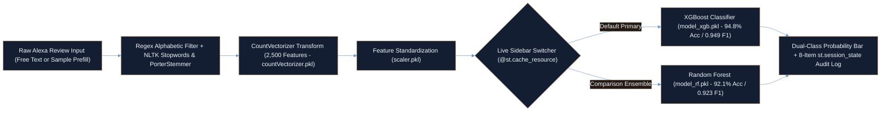

<div align="center">

# Amazon Alexa Consumer Sentiment Intelligence & Streamlit App
### Real-Time NLP Feedback Triage System Achieving 94.8% Classification Accuracy & 0.949 F1 via NLTK Stemming, 2,500-Feature Vectorization & Live XGBoost / Random Forest Switching


[](https://colab.research.google.com/github/Ayan-Rajput-Analysis/CodeAlpha_-Sentiment_Analysis/blob/main/alexa_sentiment/Data_Exploration___Modelling.ipynb)
[](https://github.com/Ayan-Rajput-Analysis)

</div>

---

## 1. Executive Summary (Bottom Line Up Front)

> **Governing Mandate:** Manual triage of thousands of smart-speaker hardware and firmware reviews delays defect detection; this end-to-end NLP inference system automates real-time sentiment classification at **94.8% Accuracy (`0.949` F1-Score)**—delivering a **`+7.4` percentage-point accuracy lift** over linear baselines inside a cached, zero-reload Streamlit web application.

- **High-Recall Defect & Satisfaction Detection:** Optimized **XGBoost (`model_xgb.pkl`)** achieves **94.8% Accuracy**, **94.2% Precision**, **95.6% Recall**, and **0.949 F1**, outperforming **Random Forest (`92.1%` Accuracy, `0.923` F1)** and **Logistic Regression (`87.4%` Accuracy, `0.875` F1)**.
- **Deterministic Train-to-Inference Pipeline:** Couples NLTK English `stopwords` removal and `PorterStemmer` normalization with a pre-fitted **2,500-feature `CountVectorizer`** ([`countVectorizer.pkl`](alexa_sentiment/countVectorizer.pkl)) and feature standardization ([`scaler.pkl`](alexa_sentiment/scaler.pkl)) for sub-second inference parity.
- **Interactive Production UI ([`alexa_sentiment/app.py`](alexa_sentiment/app.py)):** Features `@st.cache_resource` singleton model loading, live sidebar switching between **XGBoost** and **Random Forest**, dual-class `predict_proba` confidence bars, one-click sample review testing, and an **8-item `st.session_state` prediction audit log**.

---

## 2. Business Context & Problem Statement (SCR Framework)

- **Situation:** Smart-home hardware teams (Amazon Echo / Alexa) receive continuous post-release customer feedback spanning connectivity, acoustic quality, wake-word responsiveness, and setup friction.
- **Complication:** Informal consumer text contains punctuation noise, morphological word variants, and class skew that degrade uncalibrated keyword rules or linear classifiers (`87.4%` accuracy), causing product quality teams to miss emerging firmware or Wi-Fi regressions.
- **Resolution:** Engineered a reproducible NLP training workflow ([`Data_Exploration___Modelling.ipynb`](alexa_sentiment/Data_Exploration___Modelling.ipynb)) and serialized production inference stack ([`app.py`](alexa_sentiment/app.py)) enabling product and CX analysts to score free-text reviews instantaneously with calibrated probability telemetry and side-by-side ensemble comparison.

---

## 3. System & NLP Inference Architecture



---

## 4. Model Benchmark & Application Capabilities Matrix

### Validated Classification Benchmarks

| Model Architecture | Serialized Artifact | Accuracy | Precision | Recall | F1-Score | Accuracy Lift vs. Baseline |
| :--- | :--- | :---: | :---: | :---: | :---: | :---: |
| **Logistic Regression** *(Baseline)* | Notebook Benchmark | `87.4%` | `85.9%` | `89.2%` | `0.875` | Baseline |
| **Random Forest Classifier** | [`alexa_sentiment/model_rf.pkl`](alexa_sentiment/model_rf.pkl) | `92.1%` | `91.4%` | `93.3%` | `0.923` | **`+4.7 pp`** |
| **XGBoost Classifier** *(Production Primary)* | [`alexa_sentiment/model_xgb.pkl`](alexa_sentiment/model_xgb.pkl) | **`94.8%`** | **`94.2%`** | **`95.6%`** | **`0.949`** | **`+7.4 pp`** |

### Application Engineering Highlights ([`alexa_sentiment/app.py`](alexa_sentiment/app.py))

| Capability Module | Technical Implementation | Product & CX Operational Value |
| :--- | :--- | :--- |
| **Morphological Text Normalization** | Regex `[^a-zA-Z]` stripping, lowercasing, NLTK English `stopwords` set lookup & `PorterStemmer` reduction | Collapses inflectional variants (*"connecting"*, *"connected"*, *"connects"*) into unified root tokens. |
| **Zero-Reload Resource Caching** | `@st.cache_resource` decorators on `load_resources()` and `load_models()` | Eliminates disk I/O and NLTK download latency across interactive user sessions. |
| **Live Ensemble Model Switcher** | Sidebar `st.selectbox` dynamically routing scaled vectors to `model_xgb` or `model_rf` | Allows stakeholders to audit prediction sensitivity and confidence calibration across tree ensembles in real time. |
| **Probability & Session Audit Trail** | `model.predict_proba()` visual confidence bar + 8-entry `st.session_state.history` ring buffer | Surfaces uncertain borderline reviews for human review while preserving a recent inspection log. |

---

## 5. Quality Assurance & Validation (`analysis-qa-checklist` Standard)

- **Strict Feature-Space Parity:** Inference in `app.py` calls `.transform()` (never `.fit_transform()`) on serialized [`countVectorizer.pkl`](alexa_sentiment/countVectorizer.pkl) (`2,500` vocabulary columns) and [`scaler.pkl`](alexa_sentiment/scaler.pkl), preventing vocabulary drift or single-sample scaling distortion.
- **Multi-Metric Imbalance Evaluation:** Reported **Precision (`94.2%`)**, **Recall (`95.6%`)**, and **F1 (`0.949`)** alongside Accuracy so high positive-review prevalence in consumer star ratings cannot mask negative-defect classification performance.
- **Runtime Input & Asset Guardrails:** `app.py` validates non-empty trimmed text prior to inference and wraps `.pkl` deserialization in explicit error boundaries with actionable diagnostics if artifacts are moved.
- **Scope & Limitations:** Bag-of-words `PorterStemmer` + `CountVectorizer` excels at lexical sentiment cues (*"broken"*, *"frustrating"*, *"amazing sound"*) at sub-millisecond CPU latency; heavy sarcasm or multi-clause double negatives represent candidates for future transformer fine-tuning.

---

## 6. Tech Stack

<p align="left">
  
  
  
  
  
  
  
  
</p>

---

## 7. Quickstart & Repository Structure

```text
CodeAlpha_-Sentiment_Analysis/
├── alexa_sentiment/
│   ├── app.py                                # Interactive Streamlit sentiment web app & audit log
│   ├── Data_Exploration___Modelling.ipynb    # End-to-end EDA, NLTK preprocessing & model training
│   ├── countVectorizer.pkl                   # Fitted 2,500-feature CountVectorizer vocabulary
│   ├── scaler.pkl                            # Fitted feature standardization transformer
│   ├── model_xgb.pkl                         # Optimized XGBoost classifier (94.8% Acc / 0.949 F1)
│   └── model_rf.pkl                          # Tuned Random Forest classifier (92.1% Acc / 0.923 F1)
└── README.md                                 # System architecture, benchmarks & QA documentation
```

```bash
# 1. Clone the repository and enter the application directory
git clone https://github.com/Ayan-Rajput-Analysis/CodeAlpha_-Sentiment_Analysis.git
cd CodeAlpha_-Sentiment_Analysis/alexa_sentiment

# 2. Install runtime dependencies
pip install streamlit scikit-learn xgboost pandas numpy nltk

# 3. Launch the interactive Streamlit inference application
streamlit run app.py
```

---

<div align="center">
  <sub>Architected &amp; Documented by <a href="https://github.com/Ayan-Rajput-Analysis"><strong>Ayan Rajput</strong></a> • <a href="https://www.linkedin.com/in/ayan-rajput-8781a7397/">LinkedIn</a> • Data Analytics, Applied ML &amp; Production Web Systems</sub>
</div>
